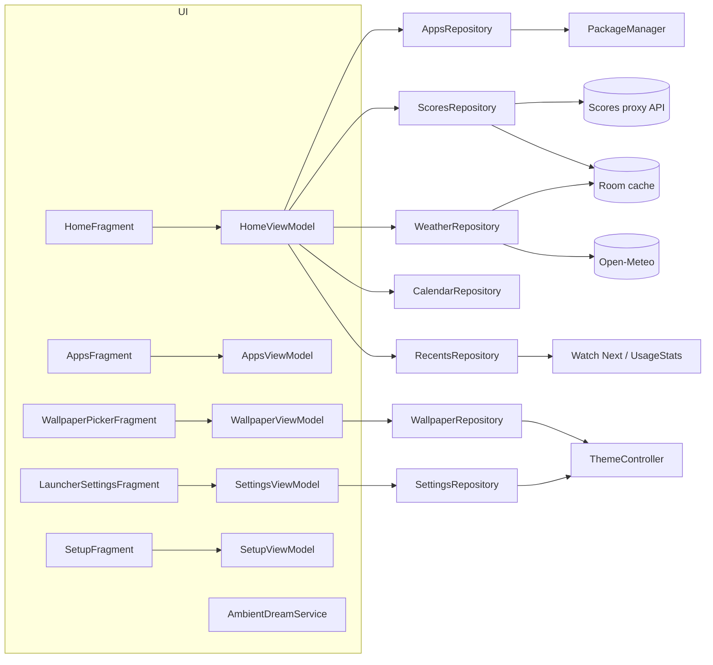

# Himal Launcher (हिमाल) — Product Requirements Document

**Product:** Android TV home-screen launcher for Nepal
**Platform:** Android TV (AOSP Android TV and Android TV boxes)
**Language / UI toolkit:** Java 17, Android Views (XML) + Material Components for Android
**Document status:** v1.0 · Ready for implementation
**Companion design:** the "Nepal Android TV Launcher" design canvas (HTML artboards listed in Appendix A)

---

## 0. How to use this document (instructions for Claude Code)

1. **Read the whole PRD once before writing code.** Sections 5 (design system), 7 (remote navigation) and 9 (settings model) are referenced by almost every screen.
2. **The design files are the visual reference; this PRD is the source of truth.** If a value in an HTML artboard and this PRD disagree, follow this PRD. HTML sizes are in CSS pixels on a 1920×1080 canvas — convert with **dp = design px ÷ 2** (Android TV renders 1080p at 960×540 dp). Do not port HTML/CSS/JS; rebuild natively.
3. **Build milestone by milestone (Section 18).** Finish a milestone, make it compile and pass its acceptance checks, then stop and summarise before starting the next.
4. **Mock data first.** Every remote data source (scores, weather) must have a `Fake…Repository` returning the demo data in Appendix B, selectable by a build flag. Never hard-code API keys; read them from `local.properties` / build config.
5. **Never invent product decisions silently.** If something is not specified, choose the simplest option consistent with this PRD, and list it under "Assumptions made" in your milestone summary.
6. **Strings, colours, dimensions and durations go in resources** (`strings.xml`, `colors.xml`, `dimens.xml`, `integers.xml`), never inline in Java.
7. **Documentation is part of done** (Section 17): README, architecture overview, Javadoc on public classes/methods.

---

## 1. Product overview

### 1.1 Problem
Android TV boxes sold in Nepal ship with generic launchers that are cluttered, slow on low-end hardware, ignore the Bikram Sambat calendar and Nepali language, and bury the most common action — watching the set-top box on HDMI.

### 1.2 Vision
A calm, remote-first home screen that gets a Nepali household to live TV in one press, shows the things they glance at (time, BS date, weather, cricket and football scores) and feels like modern Android (Material 3 Expressive).

### 1.3 Target users
- Households watching a cable / DishHome set-top box through HDMI, plus streaming apps.
- Mixed ages; many users prefer Nepali; some use other languages.
- Hardware: low-cost Android TV boxes (1–2 GB RAM, Android 9–12) and newer TVs.

### 1.4 Goals (measurable)
| Goal | Metric |
|---|---|
| One-press live TV | From launcher start, **OK** on the default focus opens the configured TV source |
| Fast | Cold start to interactive Home ≤ 2.0 s on a 2 GB device; focus move ≤ 100 ms; steady 60 fps on focus animation on mid devices, ≥ 30 fps on low-end |
| Glanceable info | Time, BS + AD date, weather and up to 4 scores visible on Home without any press |
| Remote-only | Every feature reachable with D-pad + OK + Back + Home; no dead ends |
| Local | Full Nepali UI; BS date everywhere; Nepali digits option |

### 1.5 Non-goals (v1)
- Playing video inside the launcher (apps and HDMI do that).
- Building our own system settings screens (we hand off to Android Settings).
- Content recommendations from our own servers.
- Touch or mouse optimisation (must not break, but not designed for).
- Phone/tablet layouts.

---

## 2. Platform and constraints

| Item | Requirement |
|---|---|
| minSdk | 26 (Android 8.0) |
| targetSdk / compileSdk | Latest API level required by Google Play at release time |
| Java | 17 language level (core library desugaring enabled) |
| Orientation | Landscape only, 16:9; layout must also work at 1280×720 (720p boxes) |
| Overscan safe area | 48 dp left/right, 27 dp top/bottom (96/54 px in design) |
| Input | D-pad remote; keyboard arrows/Enter/Esc must also work |
| Distribution | Google Play (Android TV) + direct APK for boxes |

**Important constraint — Google TV.** Devices running the Google TV experience may not let users choose a third-party home app. The app must still install and run as a normal TV app (it appears in the app list and can be opened) and must detect whether it is the current default home (`PackageManager.resolveActivity` for `ACTION_MAIN` + `CATEGORY_HOME`). If not default, show a dismissible banner on Home: "Set Himal as your home screen" with instructions for that device type. Do not attempt to bypass system restrictions.

**Low-end constraint.** Blur (`RenderEffect`) exists only on API 31+. On API < 31 or devices flagged low-RAM (`ActivityManager.isLowRamDevice()`), glass panels use the solid translucent fallback colour and tile entrance stagger is disabled (Section 12).

---

## 3. Technology stack

| Layer | Choice | Purpose |
|---|---|---|
| Language | Java 17 | Team preference |
| UI | Android Views, XML layouts, `RecyclerView`, `ConstraintLayout` | Screens and rows |
| Design components | Material Components for Android (latest stable, Material 3 theme) | Theme, shapes, colour roles, buttons, chips, dialogs |
| Transitions | `MaterialFadeThrough`, `MaterialSharedAxis`, `MaterialContainerTransform` (Material Components) | Page and app-launch motion (Section 5.7) |
| Springs | AndroidX DynamicAnimation (`SpringAnimation`) | Focus scale and corner morph |
| Dynamic colour | Material Color Utilities (Java) + `DynamicColors` | Wallpaper-seeded palettes |
| Architecture | AndroidX ViewModel + LiveData, Repository pattern | MVVM |
| Dependency injection | Hilt | Wiring repositories and services |
| Async | `ExecutorService` (single + IO pool) wrapped in a small `AppExecutors`; `ListenableFuture` where an AndroidX API returns one | Background work without Kotlin coroutines |
| Persistence — settings | SharedPreferences behind a `SettingsRepository` (typed getters/setters, change listener → LiveData) | Launcher settings |
| Persistence — cache | Room | Scores, weather, favourites order, recents |
| Background refresh | WorkManager | Periodic weather/score refresh |
| Networking | Retrofit + OkHttp + Moshi (or Gson) | HTTP + JSON |
| Images | Glide | Wallpapers, app banners |
| TV APIs | `androidx.tvprovider` (Watch Next), `TvInputManager`, `UsageStatsManager`, `DreamService` | Continue row, HDMI, recents, Ambient |
| Local photo transfer | NanoHTTPD (embedded server) + ZXing (QR code) | "Send photo from your phone" |
| Crash / config | Firebase Crashlytics + Remote Config | Stability and kill-switches for heavy effects |
| Testing | JUnit 4, Robolectric, Espresso, AndroidX Test, Macrobenchmark + Baseline Profiles | Quality and performance |

Do **not** use AndroidX Leanback `BrowseSupportFragment` / `RowsSupportFragment` for main screens — their fixed look conflicts with this design. Leanback utilities (e.g. `BaseGridView` focus helpers) may be used if helpful.

---

## 4. Architecture

### 4.1 Pattern
Single-activity-per-surface MVVM:
- `HomeActivity` (the HOME launcher activity) hosts fragments: `HomeFragment`, `AppsFragment`, `LauncherSettingsFragment`, `WallpaperPickerFragment`, `SetupFragment`.
- `AmbientDreamService` is a separate `DreamService` (Ambient mode).
- Each fragment has a ViewModel exposing LiveData UI state objects (immutable). Views never call repositories directly.



### 4.2 Package / folder structure
```
app/src/main/java/np/himal/launcher/
  HimalApp.java                     // Application, Hilt entry
  core/
    executors/AppExecutors.java
    focus/                          // focus engine (Section 7)
      FocusMemoryRecyclerView.java
      TileFocusAnimator.java
      RowFocusCoordinator.java
    theme/
      ThemeController.java          // dark/light/auto + seed palette application
      SeedPalettes.java
      WallpaperColorExtractor.java
    motion/Motion.java              // durations, interpolators, transition factories
    calendar/BikramSambat.java      // BS <-> AD conversion
    util/NepaliDigits.java, Units.java
  data/
    settings/SettingsRepository.java, SettingsKeys.java
    apps/AppsRepository.java, AppEntry.java, FavouritesDao.java
    recents/RecentsRepository.java
    scores/ScoresRepository.java, ScoresApi.java, FakeScoresRepository.java, model/…
    weather/WeatherRepository.java, OpenMeteoApi.java, FakeWeatherRepository.java, WeatherCodeMapper.java
    wallpaper/WallpaperRepository.java, PhotoTransferServer.java
    tv/TvInputHelper.java
    db/AppDatabase.java
  ui/
    home/HomeActivity.java, HomeFragment.java, HomeViewModel.java, adapters/…, dialogs/ScoreDetailDialog.java, WeatherDialog.java
    apps/AppsFragment.java, AppsViewModel.java, AppContextMenu.java
    settings/LauncherSettingsFragment.java, SettingsViewModel.java, OptionPickerDialog.java, ResetConfirmDialog.java, SettingsPreviewView.java
    wallpaper/WallpaperPickerFragment.java, WallpaperViewModel.java, AddPhotoDialog.java
    setup/SetupFragment.java, SetupViewModel.java
    ambient/AmbientDreamService.java
    common/GlassPanel.java, ScoreChip.java, AppTileView.java, CookieShapeDrawable.java
  work/RefreshWorker.java
app/src/main/res/
  layout/, values/, values-night/, values-ne/ (+ other locales), font/, drawable/ (Material Symbols vectors), raw/ (bs_calendar.json)
```

### 4.3 Key rules
- UI state classes are immutable value objects (`HomeUiState`, `ScoreItem`, `WeatherUi` …).
- All network/disk work runs on `AppExecutors.io()`; results posted to LiveData on main thread.
- Repositories expose `LiveData<Resource<T>>` where `Resource` = `{status: LOADING|SUCCESS|STALE|ERROR, data, updatedAt}`.
- Settings changes propagate instantly via `SettingsRepository.observe(key)`; theme/wallpaper changes trigger `ThemeController.apply()` which recreates views without restarting the activity where possible (or `recreate()` with saved focus).

---

## 5. Design system

Style: **Material 3 Expressive**, inspired by Android 17 — tonal colour seeded from the wallpaper, frosted-glass panels over the wallpaper, bold rounded shapes that morph on focus, springy motion, expressive variable typography.

### 5.1 Units
- Design canvas: 1920×1080 px. **Android dp = px ÷ 2.** Text: **sp = px ÷ 2**.
- Spacing scale (dp): 2, 4, 6, 8, 10, 12, 16, 20, 24, 28, 32, 48.
- Screen padding: 48 dp horizontal, 27 dp vertical (overscan-safe).

### 5.2 Colour roles
Implement as theme attributes (`?attr/…`) with `values/` (light) and `values-night/` (dark) or, preferably, two explicit themes switched by `ThemeController` (because "Auto by time" is not the same as system night mode).

**Neutral roles**
| Role (attr name) | Dark | Light | Used for |
|---|---|---|---|
| `colorBackground` (bg) | `#111318` | `#F9F9FF` | Screen background |
| `colorBackgroundAmbient` | `#0D0F14` | `#F2F3FA` | Ambient mode |
| `colorSurfaceContainer` (surface/tile) | `#1D2027` | `#EDEDF4` | Tiles, rows, cards |
| `colorSurfaceContainerHigh` | `#272A31` | `#E7E8EE` | Dialogs |
| `colorSecondaryContainer` (selected) | `#3A4558` | `#DAE2F9` | "All apps" tile, picker selected row |
| `colorOutline` (border) | `#3A3E47` | `#C4C6D0` | Thin dividers only |
| `colorOutlineVariant` (line2) | `#44474E` | `#C4C6D0` | Secondary button outline |
| `colorOnSurface` (text) | `#E2E2E9` | `#191C20` | Primary text, focus ring |
| `colorOnSurfaceVariant` (text2) | `#C4C6D0` | `#44474E` | Secondary text |
| `textMuted2` | `#A9ABB5` | `#5A5D66` | Chip secondary text |
| `textMuted` | `#8E9099` | `#5D5F67` | Captions, hints |
| `scrim` | `rgba(8,10,14,0.62)` | `rgba(25,28,32,0.32)` | Behind dialogs |
| `glass` | `rgba(29,32,39,0.62)` | `rgba(249,249,255,0.68)` | Glass panels (blur 28 dp-equivalent radius + saturation 1.4 on API 31+) |

**Seed (accent) roles** — chosen by wallpaper or by Settings › Theme › Colour.
| Seed | Theme | primary | onPrimary | primaryContainer | onPrimaryContainer |
|---|---|---|---|---|---|
| mountain (default, blue) | Dark | `#A8C7FA` | `#062E6F` | `#284777` | `#D6E3FF` |
| | Light | `#415F91` | `#FFFFFF` | `#D6E3FF` | `#001B3E` |
| phewa (coral) | Dark | `#FFB59F` | `#5D1A07` | `#7B2F19` | `#FFDBD1` |
| | Light | `#8F4C38` | `#FFFFFF` | `#FFDBD1` | `#3A0B01` |
| night (indigo) | Dark | `#BAC3FF` | `#222C61` | `#394379` | `#DEE0FF` |
| | Light | `#525B92` | `#FFFFFF` | `#DEE0FF` | `#0D154B` |
| terai (green) | Dark | `#B1D18A` | `#1F3701` | `#354E16` | `#CDEDA3` |
| | Light | `#4C662B` | `#FFFFFF` | `#CDEDA3` | `#102000` |
| flags (saffron) | Dark | `#FFB870` | `#4A2800` | `#6A3C00` | `#FFDCBE` |
| | Light | `#8B5000` | `#FFFFFF` | `#FFDCBE` | `#2C1600` |

For a **user photo** wallpaper, compute the seed with Material Color Utilities (`QuantizerCelebi` → `Score.score()` → first colour) and generate a `SchemeTonalSpot` for dark and light. Cache the result keyed by the photo file hash.

**Wallpaper legibility tint** (drawn over photo/illustrated wallpapers, not over the default Mountain scene or Plain): dark `rgba(14,16,20,0.46)`, light `rgba(244,241,235,0.58)`. "Dim wallpaper" adds 0 / 0.14 / 0.26 alpha on top.

**Contrast rule:** all text ≥ 4.5:1 against its actual background (including over wallpapers with tint). Verify in tests for each seed × theme.

### 5.3 Typography
Bundle fonts in `res/font/` (TVs may be offline):
- **Roboto Flex** (variable; axes wght, wdth, opsz) — all Latin UI.
- **Noto Sans Devanagari** (400/500/600) — Nepali, Hindi, Maithili, Bhojpuri, Newar, Tharu, Tamang.
- **Mukta** (optional typeface choice in Settings).
- Other scripts fall back to system fonts (Noto family on Android).

| Style | Size (sp) | Weight | Width (wdth) | Usage |
|---|---|---|---|---|
| Clock (Home) | 64 | 500 | 125 | Home clock |
| Clock (Ambient) | 120 | 300 | 100 | Ambient clock |
| Display | 32 | 400–600 | 112 | Setup titles |
| Headline | 19 | 600 | 112 | Watch TV label, dialog titles |
| Title | 13 | 600 | 100 | Section titles ("Continue", "Favourites") — sentence case |
| Body large | 12–13 | 400–500 | 100 | Tiles, menu pills, rows |
| Body | 11 | 400 | 100 | Chips, captions |
| Caption | 10 | 400 | 100 | Hints, "Updated 2 min ago" |

Minimum on-screen text: **11 sp** (22 px). Text size setting multiplies all sizes by 1.0 / 1.15 / 1.3.

### 5.4 Shape
| Element | Corner radius (dp) | Focused radius (dp) |
|---|---|---|
| Watch TV tile | 18 | 22 |
| Continue tiles | 16 | 22 |
| Favourites / Apps grid tiles | 14 | 22 |
| App icon container | 12–16 (fully round on Continue) | — |
| Menu pills, buttons, chips (filter) | fully rounded (height ÷ 2) | — |
| Score chips | 8 | — |
| Rows in Settings | 12 | — |
| Dialogs | 18 | — |
| Setup option cards | 16 | 22 |

Watch TV badge: Material 3 Expressive **"cookie"** shape — a 9-lobe rounded scallop (radius r(θ) = R·(1 + 0.085·cos 9θ)), 40 dp, filled `primary`, with `live_tv` icon in `onPrimary`. Implement as `CookieShapeDrawable` (Path).

### 5.5 Icons
- Use **Material Symbols Rounded, filled** (Apache 2.0) as VectorDrawables (`res/drawable/ic_*.xml`). Required: `settings, photo_library, folder, language, shop, partly_cloudy_day, live_tv, apps, movie, smart_display, play_circle, tv, connected_tv, newspaper, music_note, radio, calendar_month, mic, clear_night, sunny, rainy, cloud, weather_snowy, thunderstorm, foggy, input, home, arrow_back, keyboard_arrow_*`.
- **Real app icons/banners come from the system** (`getApplicationBanner()` → fallback `getApplicationIcon()`), never drawn by us. The coloured placeholder squares in the design represent "an app icon goes here".
- System apps (Settings, Photos/Gallery, Files, Browser, Play Store, Weather) without a banner use the themed icon style: `primaryContainer` square with the Material Symbol in `onPrimaryContainer`.

### 5.6 Elevation & glass
- No drop shadows on tiles. Separation by tonal surface colour.
- Glass panels (Home header pills, weather chip, search, gear, score chips, Apps filter bar): `glass` colour + `RenderEffect.createBlurEffect(56px, 56px)` applied to a captured wallpaper layer behind the panel on API 31+. Fallback: solid `glass` colour.

### 5.7 Motion
Interpolators (define in `core/motion/Motion.java`):
| Name | Curve | Use |
|---|---|---|
| Emphasized decelerate | `PathInterpolator(0.05f, 0.7f, 0.1f, 1f)` | Entering elements |
| Emphasized accelerate | `PathInterpolator(0.3f, 0f, 0.8f, 0.15f)` | Exiting elements |
| Standard | `PathInterpolator(0.2f, 0f, 0f, 1f)` | Slides |
| Focus spring | `SpringAnimation`, stiffness 600 (≈ MEDIUM_LOW–MEDIUM), damping ratio 0.6 | Focus scale + corner morph |

| Moment | Transition | Duration | Detail |
|---|---|---|---|
| Home ↔ Apps ↔ Settings (top-level) | `MaterialFadeThrough` | 300 ms in (90 ms delay), 120 ms out | Incoming scales 0.94 → 1 |
| Into deeper screen (Settings › Wallpaper, Setup) | `MaterialSharedAxis(X, forward=true)` | 450 ms in, 250 ms out | ±120 dp slide + fade |
| Back from deeper screen | `MaterialSharedAxis(X, forward=false)` | same | reversed |
| Screen entry tile stagger | Translate Y +14 dp → 0, alpha 0 → 1 | 420 ms, +40 ms per item (max 5 steps) | Emphasized decelerate; disabled on low-end |
| Open app from tile | `MaterialContainerTransform` tile → full screen, then launch intent | 520 ms | Use tile icon colour as container colour; on Back from the app, focus returns to the same tile |
| Dialog (score, weather, picker, reset) | Scrim fade 220 ms + dialog translateY 14 dp & scale 0.94 → 1 | 420 ms | Emphasized decelerate |
| Focus | Scale 1.0 → 1.06 (pills 1.08) + corner radius → focused value | Spring | 3 dp outline ring in `colorOnSurface`, 2.5 dp offset |
| Ambient in / out | Cross-fade | 900 ms in / 600 ms out | |
| HDMI input banner | Slide down 20 dp + fade, hold, fade out | 3.6 s total | |

**Reduced motion:** if `Settings.Global.ANIMATOR_DURATION_SCALE == 0` or launcher setting Animations = Off → no transitions, instant focus change (ring only, no scale). Animations = Reduced → keep fades, drop slides, stagger and springs.

---

## 6. Screens and features

Each screen lists: purpose, layout (dp), behaviour, remote navigation, states, acceptance criteria (AC). Design artboard names are in brackets — see Appendix A.

### 6.1 First-run setup [Setup.dc.html]
**Purpose:** configure the four things that shape daily use. Shown on first launch as home (flag `setup_completed=false`) and from Settings › "Run first-time setup".

**Layout:** wallpaper (Mountain scene) background. Header: wordmark "हिमाल" + "Launcher setup" left; "Step n of 4" + 4 progress dots right (current dot 16 dp wide pill, completed dots `primary`). Title (Display), subtitle (Body large), options grid (4 columns, card min 160×56 dp), footer: Back (outlined, hidden on step 1), Continue (filled `primary`) / Finish on step 4, and a hint "◀ ▲ ▼ ▶ move · OK select · Back previous step · change any of this later in Settings".

**Steps**
1. **Language** — 11 cards (native name + English name): English, नेपाली, मैथिली, भोजपुरी, नेपाल भाषा, थारू, तामाङ, हिन्दी, বাংলা, 中文（简体）, 日本語 + "More languages" card opening the full list dialog (42 languages, Appendix C, 4-column scrollable grid). A language chosen from the full list appears in the main grid as the 12th card, selected. Choosing a language applies it immediately (`AppCompatDelegate.setApplicationLocales`).
2. **Where do you watch TV?** — cards for each TV input from `TvInputManager` (label + status "Signal detected" / "No signal"), plus "Antenna (DTV)" if a tuner input exists and "Use an app" (opens app chooser listing installed live-TV apps). Pre-select the first HDMI input reporting a signal (if the API cannot report signal, pre-select HDMI 1 and say "Recommended").
3. **Which scores should Home show?** — multi-select cards: NPL, Premier League, LaLiga, Champions League, IPL, NBA, Formula 1, Tennis. Default: NPL, Premier League, LaLiga, Champions League. Selected cards show "✓ ".
4. **Pick a look** — Auto (Recommended), Dark, Light. Applies immediately.

Selected card: `primaryContainer` bg, `onPrimaryContainer` text. Unselected: `surfaceContainer`.
Finish → saves settings, sets `setup_completed=true`, shared-axis back to Home.
If usage access permission is not granted, after step 4 show a one-time card: "Show your recently used apps on Home?" → opens `Settings.ACTION_USAGE_ACCESS_SETTINGS` (skippable).

**Remote:** focus starts on the selected card (or first). Back = previous step; on step 1 Back does nothing. Full-list dialog: Back closes it.
**AC:** setup completes with remote only; each step's choice is visible immediately (language/theme); re-running setup pre-fills current values.

### 6.2 Home [Main.dc.html, HomeLight, HomePhewa, HomeNight, HomeFlags]
**Purpose:** the home screen. Glanceable info + one-press TV + recent and favourite apps.

**Layout (top → bottom, 960×540 dp canvas, 48/27 dp padding):**
1. **Header bar (36 dp tall)**
   - Left: glass pill container with three menu pills **Home · Apps · Settings** (each 30 dp high, 15 dp horizontal padding). Current = `primaryContainer` filled.
   - Right (gap 8 dp): **Weather chip** (glass; condition icon in `primary`, temperature bold, condition text, "H 21° L 9°" muted), **Search** button (glass; `primary` circle with `mic` icon + "Search"), **Gear** button (glass circle, `settings` icon) — opens Android TV settings.
2. **Time block** (top margin 20 dp): clock (Clock style) + column: BS date (Noto Sans Devanagari 17 sp, e.g. "शुक्रबार, कार्तिक २७, २०८३"), AD date (12 sp, e.g. "Friday, 13 November 2026"), weather summary line with icon (11 sp, e.g. "Sunny morning, rain from 2 PM, clear tonight").
3. **Scores row** (top margin 11 dp): up to N score chips (glass, radius 8 dp, 28 dp high): optional `LIVE` badge (`primary` fill, `onPrimary` text) · league · score · status; then caption "Updated 2 min ago". Chips are focusable.
4. **Continue row** (title "Continue"): horizontally scrolling. First item **Watch TV tile** (220×120 dp, `primaryContainer`, cookie badge, "Watch TV" + source caption e.g. "HDMI 1 · Set-top box"). Then up to 8 recent items (150×120 dp, `surfaceContainer`, 32 dp round icon, app name, relative time "Resume · 2 h ago").
5. **Favourites row** (title "Favourites · hold OK to pin or move"): 112×66 dp tiles (icon 24 dp + name), then an **All apps** tile (`secondaryContainer`, `apps` icon) linking to Apps.

**Behaviour**
- **Default focus on start / Home key:** Watch TV tile.
- **Watch TV:** opens the configured source (Section 6.9).
- **Recent / favourite tile OK:** container-transform then launch the app's leanback launch intent. **Long-press OK** opens the app context menu (6.5).
- **Score chip OK:** opens Score detail dialog (6.3). **Weather chip OK:** Weather dialog (6.4). **Search:** voice search (6.11). **Gear:** Android TV settings (6.10).
- **Home key pressed while already on Home:** scroll rows to start and focus Watch TV.
- **Not default home:** dismissible banner above the Continue row (Section 2).
- **Settings-driven visibility:** Watch TV tile (First in row / Hidden), Continue row (Show/Hide), weather (Show/Hide), scores (league list, max count, live first, stale behaviour), wallpaper, theme, text size, tile size/shape/labels.
- Clock updates every minute on the minute (`Intent.ACTION_TIME_TICK`); date at midnight; 12/24-hour per setting.

**States**
| Area | Loading | Empty | Error / stale |
|---|---|---|---|
| Weather | chip shows last cached value; skeleton pill if none | — | hide temperature, show "Weather unavailable" in chip if no cache |
| Scores | last cached chips | no leagues selected → hide row | if data older than 15 min: "Scores unavailable" chip (or hide, per setting); caption shows real age |
| Continue | Watch TV tile always present | only Watch TV tile | — |
| Favourites | — | default favourites (first 8 TV apps alphabetically) | — |

**AC:** cold start focuses Watch TV; OK on it switches input; Back on Home does nothing (no exit, no flicker); every element reachable with D-pad; row focus memory works (Section 7).

### 6.3 Score detail dialog
Right-aligned dialog (300 dp wide, full height minus padding), `surfaceContainerHigh`, radius 18 dp. Content: league label (+ "· LIVE"), home team + score, away team + score (scores 20 sp), long status ("Yaks need 53 from 40 balls" / "Full time" / "Second half · 67 minutes"), venue · "Updated n min ago", **Close** button (`primary`). Live data refreshes every 30 s while open. Back or Close returns focus to the same chip.

### 6.4 Weather dialog
Right-aligned dialog (380 dp wide). Content:
- "{Location} · Today"
- Large icon (44 dp) + current temperature (44 sp) + condition, "High · Low", "Wind {speed} · Rain today {amount}".
- One-line day summary (generated, Section 8.3).
- 4 day-part cards (Morning 06–12, Afternoon 12–17, Evening 17–21, Night 21–06): label, icon, temperature, note ("Sunny", "Rain 70%").
- Next 3 days rows: day, icon, condition, rain probability, high / low.
- Mountain line: "Mountains · Namche Bazaar −6°, snow showers" (Namche weather from the same API).
- Close button + link "Change units in Settings" (opens Settings › Weather).
All values use the units setting (°C/°F, km/h|m/s|mph, mm|inches).

### 6.5 Apps grid [AppDrawer.dc.html]
**Layout:** header: "Home" text link (Back target) · title "Apps" · glass filter bar with pill tabs **All · Watch · Listen · Tools** · clock right. Grid: 6 columns of 16:9 tiles (gap 14×16 dp), tile = icon 28 dp + name. Footer: "◀ ▲ ▼ ▶ move · OK open · hold OK to pin to Favourites · Back to Home" + "Selected: {app}".

**Data:** all activities resolving `ACTION_MAIN` + `CATEGORY_LEANBACK_LAUNCHER`, sorted alphabetically (locale-aware collator). Category mapping: from `ApplicationInfo.category` (`CATEGORY_VIDEO` → Watch, `CATEGORY_AUDIO` → Listen, others → Tools) with an overrides table for common Nepal apps (NetTV, DishHome Go, Kantipur TV → Watch; Radio Nepal → Listen; Hamro Patro → Tools). Update on `ACTION_PACKAGE_ADDED/REMOVED/CHANGED`.

**App context menu (long-press OK, also on Home tiles):** Pin to Favourites / Unpin · Move (enters move mode: ◀ ▶ reorder, OK to drop, Back cancels) · App info (`ACTION_APPLICATION_DETAILS_SETTINGS`) · Uninstall (`ACTION_DELETE`, hidden for system apps).

**AC:** new installs appear without restart; filters work; focus memory per filter; move mode persists order in Room.

### 6.6 Launcher settings [Settings.dc.html, SettingsLight]
**Layout:** header ("Home" link · "Launcher settings" · clock). Three columns:
1. **Categories** (150 dp): pill buttons — Theme, Wallpaper, Font, Language, Weather, Home screen, Live TV, Icons & tiles, Scores, Screensaver; current = `primaryContainer`. Bottom: "Run first-time setup" (dashed outline).
2. **Options** (330 dp): category title, option rows (38 dp high, radius 12, `surfaceContainer`): label · ◀ value ▶. Scores category additionally shows league chips (6.6.2). Wallpaper category shows a "Browse wallpapers or add your own photo ▶" row. Bottom: "Reset to default" (outlined).
3. **Preview** (374×210 dp): live miniature of Home reflecting every setting (theme, colour, wallpaper, font, text size, language, calendar, time format, tile size/shape/labels, Watch TV tile & caption, weather text, scores). Hint below: "▲ ▼ move · ◀ ▶ change value · OK shows all options · Back returns to categories. Changes apply instantly."

**Interaction**
- ▲▼ move between rows; **◀ ▶ step the focused row's value** (wraps); **OK opens Option picker dialog** listing all values (current ticked, focused on open); OK selects and closes; Back closes.
- From the categories column, ▶ enters the options column. **Back from options → focus current category; Back from categories → Home.**
- **Reset to default** opens confirmation dialog ("Reset all launcher settings?" · body · **Cancel** (focused, filled) · Reset). Reset does not affect installed apps or favourites order.
- All changes persist immediately and apply live to Home/Apps/Ambient.

#### 6.6.1 Options per category
See Section 9 for keys, types and defaults.
- **Theme:** Mode (Auto by time / Dark / Light), Colour (From wallpaper / Coral / Green), Contrast (Standard / High), Animations (Full / Reduced / Off).
- **Wallpaper:** Wallpaper (Mountain scene / Ridge line / Plain / Photo slideshow), Dim (Off / 30% / 60%), Change photo every (1 day / 1 hour / Never). Row "Browse wallpapers or add your own photo" → Wallpaper picker.
- **Font:** Typeface (Roboto Flex / Mukta / Noto Sans), Text size (Default / Large / Extra large), Nepali digits (Off / On).
- **Language:** Language (42 languages, Appendix C), Calendar (Both / Bikram Sambat / Gregorian), Time format (12-hour / 24-hour).
- **Weather:** Temperature (°C / °F), Wind speed (km/h / m/s / mph), Rainfall (mm / inches), Location (Kathmandu / Pokhara / Biratnagar / Bharatpur / Use TV location), Show on Home (Show / Hide).
- **Home screen:** Watch TV tile (First in row / Hidden), Continue row (Show / Hide), Favourites order (Most used / Manual), Health line (Ambient only / Home and Ambient / Off).
- **Live TV:** Watch TV uses (TV input / App); if TV input → Input source (list from TvInputManager); if App → App (installed live-TV apps + "Ask every time"); Open when TV starts (Off / On).
- **Icons & tiles:** Tile size (Medium / Large / Small), Tile shape (Rounded / Square / Pill), App names (Show / Hide).
- **Scores:** league chips + Show on Home (Up to 4 / 6 / 3 / 2), Live matches first (On / Off), If scores can't update (Say "unavailable" / Hide scores).
- **Screensaver:** Start after (10 / 5 / 30 minutes / Never) → writes system screensaver timeout only if permitted, otherwise deep-links to the system Screensaver settings; Show live scores (On / Off); Move clock to protect screen (On / Off); Dim at night (11 PM – 6 AM / Off).

#### 6.6.2 League chips (Scores category)
Grouped rows (label column 70 dp + wrapping chips, radius 6 dp): Cricket (NPL, IPL, Big Bash, International) · Football (Premier League, LaLiga, Champions League, Serie A, Bundesliga, Ligue 1) · Basketball (NBA, EuroLeague) · US sports (NFL, NHL, MLB) · Tennis (ATP, WTA) · Motorsport (Formula 1, MotoGP) · Golf (PGA Tour). Selected chip: "✓ " prefix + `primaryContainer`. Header text: "Pick what shows on Home · {n} selected".

**AC:** every option changes the preview instantly and the real Home on return; ◀▶ and picker both work; Back hierarchy as specified; reset confirmation defaults to Cancel.

### 6.7 Wallpaper picker [Wallpaper.dc.html]
**Layout:** header ("Settings" link = Back target · "Wallpaper" · clock). Left: large preview (520×292 dp) showing the selected wallpaper with tint and a miniature Home overlay; below: "Dim" segmented pills (Off / 30% / 60%) and **Set as wallpaper** (filled `primary`; label becomes "✓ Wallpaper set" when applied); caption "Current wallpaper: {name}". Right: "Built-in" 2-column grid of 16:9 thumbnails with names (current marked "● "); "Add your own photo" buttons: **From your phone**, **USB drive**, **Google Photos**.

**Built-in wallpapers** (vector illustrations; ship as VectorDrawables or 1920×1080 WebP):
| Name | Seed | Description |
|---|---|---|
| Mountains (default) | mountain | Three flat tonal ridges with snow caps, colours follow theme |
| Phewa sunset | phewa | Warm banded sky, sun, Machhapuchhre-like peak reflected in a lake, small boat |
| Himalaya night | night | Starry sky, crescent moon, snowy peaks, a hut with a lit window |
| Terai fields | terai | Blue sky, sun, mustard and green field bands, trees |
| Prayer flags | flags | Blue sky, white mountain, string of five-colour prayer flags |
| Plain | mountain | Background colour only |

**Selection changes the whole picker's accent colour (dynamic colour preview).**

**Add your own photo**
- **From your phone:** start `PhotoTransferServer` (NanoHTTPD on a random free port, LAN only, one-time 6-digit token in URL). Show dialog with QR code (ZXing) of `http://{tv-ip}:{port}/?t={token}`, text "Scan this code with your phone camera, then pick any photo. It appears on the TV in a few seconds." and "Your phone and TV need to be on the same Wi-Fi." The served page is a minimal HTML upload form (JPEG/PNG/HEIC→reject with message, ≤ 20 MB). On upload: save to app-private storage, downscale to 1920×1080 (centre-crop), compute seed, preview it, stop server. Server auto-stops after 10 minutes or on dialog close.
- **USB drive:** list images from mounted removable storage via `StorageManager` / Storage Access Framework picker if available on the device; show a grid of thumbnails to choose.
- **Google Photos:** v1 shows the dialog with explanation and "Coming soon" state (behind a Remote Config flag). Do not implement OAuth in v1.

**AC:** applying a wallpaper updates Home and the accent colour everywhere; user photo survives reboot; transfer server never exposed when dialog closed.

### 6.8 Ambient mode [Today.dc.html, AmbientLight]
Implemented as `AmbientDreamService` (registered with `android.service.dreams.DreamService` intent filter and `BIND_DREAM_SERVICE` permission) so the system idle timer triggers it.
**Layout:** wallpaper (ambient tone), clock (Clock Ambient style), BS date (20 sp light), AD date + weather line ("Kathmandu 14° clear · rain earlier today"), health line (label "स्वास्थ्य" in `primary` + daily sentence, Appendix D) if enabled, bottom: live dot + scores line + "· updated n min ago" + "Press any button".
**Burn-in protection:** every 60 s move the content block by one of 4 offsets (0,0), (+14,−9), (−10,+7), (+7,+11) dp with a 2 s ease.
**Night dim:** 23:00–06:00 alpha 0.55 (setting).
**Exit:** any key → `finish()` (system returns to Home).
**AC:** starts from system screensaver settings; no static element stays in place > 60 s; CPU wake-ups ≤ once per minute.

### 6.9 Watch TV / input switching
- **TV input mode:** launch `Intent.ACTION_VIEW` with `TvContract.buildChannelUriForPassthroughInput(inputId)`. If the TV's input UI cannot be launched, fall back to the system TV app (`com.android.tv` / vendor package resolved via `TvInputManager`) or show "This TV doesn't allow switching inputs from apps. Use the Input button on your remote."
- **App mode:** launch the chosen app's leanback intent; "Ask every time" shows a chooser dialog of live-TV apps.
- **Open when TV starts:** on `BOOT_COMPLETED` / first Home resume after boot, auto-open the source once.
- Caption under "Watch TV" shows the current source label (input label or app name).
- **AC:** source change in Settings updates the caption immediately; failure path shows the message, never a crash.

### 6.10 Android TV settings (gear)
Gear button on Home header: `startActivity(new Intent(Settings.ACTION_SETTINGS))` with container-transform from the gear. If `KEYCODE_SETTINGS` is delivered to the launcher, do the same. On return, focus the gear.

### 6.11 Voice search
Search button (and `KEYCODE_SEARCH`): launch `Intent.ACTION_ASSIST` (or `RecognizerIntent.ACTION_WEB_SEARCH` / `SearchManager` global search fallback). If no assistant is installed, show "Voice search isn't available on this TV." Text search is out of scope for v1.

---

## 7. Remote navigation (global rules)

### 7.1 Key mapping
| Key | Action |
|---|---|
| D-pad ▲▼◀▶ | Move focus spatially (nearest focusable in that direction). In Settings rows, ◀▶ change the value. |
| OK / Enter / D-pad centre | Activate focused item |
| Long-press OK (≥ 500 ms) | Context menu on app tiles |
| Back | Close dialog → else go up one level (table below) |
| Home | Return to Home, focus Watch TV, rows scrolled to start |
| Search / Assist | Voice search |
| Settings key | Android TV settings |
| Menu | Context menu on focused app tile (same as long-press) |

### 7.2 Back behaviour
| Where | Back does |
|---|---|
| Any dialog / picker / context menu | Close it; focus returns to the element that opened it |
| Home | Nothing (consume the event; never exit) |
| Apps | Home (fade through) |
| Settings — options column | Focus current category |
| Settings — categories column | Home |
| Wallpaper picker | Settings › Wallpaper (shared axis back) |
| Setup step n > 1 | Previous step |
| Setup step 1 | Nothing |
| Move mode (reordering) | Cancel move |

### 7.3 Focus engine requirements
1. **Initial focus** per screen: Home → Watch TV tile; Apps → first tile of current filter; Settings → current category; Wallpaper → current wallpaper thumbnail; Setup → selected card; dialogs → primary action (Close / current option / Cancel for destructive).
2. **Row memory:** when moving vertically into a row, focus the item last focused in that row (not the geometrically nearest). Implement in `RowFocusCoordinator` (store adapter position per row id).
3. **Scroll alignment:** horizontal rows keep the focused item at a fixed position ~150 dp from the left edge once the row has scrolled (Android TV style "focus stays, content moves"); first items are not offset.
4. **Focus visuals:** focused element scales 1.06 (pills 1.08), shows a 1.5 dp `colorOnSurface` outline ring offset 2.5 dp, tiles morph corner radius to the focused value; z-order above neighbours (`setTranslationZ`). Unfocus animates back.
5. **No focus traps:** every screen must allow reaching the header and leaving any row. Add Espresso tests that walk all focusables.
6. **Focus restore** after configuration change, theme change, returning from an app/Settings, or package list update.

---

## 8. Data and integrations

### 8.1 Installed apps & banners
- Query `queryIntentActivities(new Intent(ACTION_MAIN).addCategory(CATEGORY_LEANBACK_LAUNCHER), 0)`. Exclude this launcher.
- Tile image: `getActivityBanner()` → `getApplicationBanner()` → icon on themed square. Cache bitmaps in an LRU (max 20 MB).
- Android 11+: declare `<queries>` for the leanback launcher intent.

### 8.2 Continue row (recents)
Priority:
1. Watch Next programs from `TvContractCompat.WatchNextPrograms` (title + app) if accessible.
2. `UsageStatsManager.queryUsageStats(INTERVAL_DAILY, now-7d, now)` → last-used TV apps, newest first, with relative time ("Resume · 2 h ago", "Yesterday", "3 days ago").
3. If permission missing: show Watch TV tile only + a small "Show recent apps" tile that opens the usage-access settings.
Max 8 items. Refresh on `onResume`.

### 8.3 Weather
- Provider: **Open-Meteo** (no key). Endpoint `https://api.open-meteo.com/v1/forecast` with `latitude, longitude, current=temperature_2m,weather_code,wind_speed_10m,is_day`, `hourly=temperature_2m,precipitation_probability,precipitation,weather_code`, `daily=weather_code,temperature_2m_max,temperature_2m_min,precipitation_probability_max,precipitation_sum`, `timezone=Asia/Kathmandu`, `forecast_days=4`. Always request metric; convert locally.
- Locations: Kathmandu (27.7172, 85.3240), Pokhara (28.2096, 83.9856), Biratnagar (26.4525, 87.2718), Bharatpur (27.6833, 84.4333), "Use TV location" = coarse IP geolocation is **not** allowed without consent → v1 maps it to the device's time-zone default (Kathmandu) and shows "Kathmandu".
- Mountain line: Namche Bazaar (27.8069, 86.7140), current temperature + code.
- Refresh: every 30 min (WorkManager, network constraint) + on Home resume if older than 30 min. Cache in Room.
- **WMO code → icon/label:** 0 clear (`sunny` / `clear_night` by `is_day`), 1–2 partly cloudy (`partly_cloudy_day`), 3 cloudy (`cloud`), 45/48 fog (`foggy`), 51–67 & 80–82 rain (`rainy`), 71–77 & 85–86 snow (`weather_snowy`), 95–99 thunderstorm (`thunderstorm`).
- **Day summary generator:** take the dominant code per day part (morning/afternoon/evening/night). Build "{Morning label} morning, {afternoon phrase}, {evening/night phrase}" with rules: rain/snow/thunder in a part → "rain from {first hour with precipitation_probability ≥ 50%}"; identical consecutive parts merge ("Sunny all day"). Localise via string resources with placeholders.
- Units: °F = round(°C×9/5+32); m/s = km/h÷3.6 (1 decimal); mph = km/h÷1.609 (round); inches = mm÷25.4 (2 decimals).

### 8.4 Sports scores
- Use a **small backend proxy** (separate repo; Cloudflare Worker or Firebase Function) that holds provider API keys, normalises data, and caches 60 s. The TV app only talks to the proxy. Provider choice is an open question (Section 19) — build against the contract below with `FakeScoresRepository` first.
- **Contract:** `GET {BASE_URL}/v1/scores?leagues=npl,pl,laliga,ucl&lang=en`
```json
{
  "updatedAt": "2026-11-13T13:55:00Z",
  "matches": [
    {
      "id": "npl-2026-29",
      "league": "npl",
      "leagueName": "NPL",
      "sport": "cricket",
      "status": "live",
      "home": { "name": "Karnali Yaks", "short": "KAR", "score": "112/3" },
      "away": { "name": "Janakpur Bolts", "short": "JAN", "score": "164/6" },
      "clock": "13.2 ov",
      "summary": "Yaks need 53 from 40 balls",
      "venue": "TU Ground, Kirtipur",
      "startTime": "2026-11-13T11:45:00Z"
    }
  ],
  "leagueStatus": [ { "league": "ipl", "message": "Starts March" } ]
}
```
  `status` ∈ `scheduled | live | ht | ft | postponed | offseason`. Chip text: `{short} {score} v {short} {score}` for cricket, `{home short} {h}–{a} {away short}` for others; status text: clock for live, `FT` for finished, kick-off time for scheduled.
- **League ids:** `npl, ipl, bbl, intl_cricket, pl, laliga, ucl, seriea, bundesliga, ligue1, nba, euroleague, nfl, nhl, mlb, atp, wta, f1, motogp, pga`.
- Refresh: every 60 s while Home is visible and any selected match is live; every 15 min otherwise; paused when screen off.
- Ordering: live first (setting), then most recent finished, then upcoming; limit to "Show on Home" count.
- Stale: data older than 15 min → "Scores unavailable" chip or hide (setting). Never show stale data labelled as live.

### 8.5 Bikram Sambat calendar
- Ship `res/raw/bs_calendar.json`: month lengths for BS 2000–2100 plus the AD anchor (BS 2000-01-01 = AD 1943-04-14). Source the table from a well-tested open-source BS converter and cite it in code comments.
- `BikramSambat.fromGregorian(LocalDate)` / `toGregorian(...)`; month and weekday names in Nepali (बैशाख … चैत्र; आइतबार … शनिबार) and English transliteration.
- Nepali digits via `NepaliDigits.format()` (०१२३४५६७८९) when language is Nepali or the digits setting is On.
- **Unit tests** must verify at least 20 known date pairs from an authoritative calendar (e.g. Nepal government calendar / Hamro Patro), including year boundaries. Verify the design sample "13 Nov 2026 = कार्तिक २७, २०८३" against the reference before using it in tests.

### 8.6 Health line
A list of short, original wellbeing sentences (Appendix D), English + Nepali, chosen by day-of-month. No medical claims, no attributions to real people.

---

## 9. Settings data model

Stored in SharedPreferences (`himal_settings`). Index-based enums are **not** allowed — store stable string values.

| Key | Type | Values | Default |
|---|---|---|---|
| `setup_completed` | bool | | false |
| `theme_mode` | string | `auto`, `dark`, `light` | `auto` (dark 18:00–06:00 local time, light otherwise) |
| `theme_colour` | string | `wallpaper`, `coral`, `green` | `wallpaper` |
| `contrast` | string | `standard`, `high` | `standard` |
| `animations` | string | `full`, `reduced`, `off` | `full` |
| `wallpaper` | string | `mountains`, `phewa`, `night`, `terai`, `flags`, `plain`, `ridge`, `photo`, `slideshow` | `mountains` |
| `wallpaper_photo_uri` | string | app-private file path | null |
| `wallpaper_dim` | int | 0, 30, 60 | 0 |
| `slideshow_interval` | string | `1d`, `1h`, `never` | `1d` |
| `typeface` | string | `roboto_flex`, `mukta`, `noto_sans` | `roboto_flex` |
| `text_scale` | float | 1.0, 1.15, 1.3 | 1.0 |
| `nepali_digits` | bool | | false |
| `language` | string | BCP-47 tag (Appendix C) | device locale if supported, else `en` |
| `calendar` | string | `both`, `bs`, `ad` | `both` |
| `time_format` | string | `12h`, `24h` | `12h` |
| `weather_temp_unit` | string | `c`, `f` | `c` |
| `weather_wind_unit` | string | `kmh`, `ms`, `mph` | `kmh` |
| `weather_rain_unit` | string | `mm`, `in` | `mm` |
| `weather_location` | string | `kathmandu`, `pokhara`, `biratnagar`, `bharatpur`, `auto` | `kathmandu` |
| `weather_show_home` | bool | | true |
| `home_watch_tile` | string | `first`, `hidden` | `first` |
| `home_continue_row` | bool | | true |
| `home_fav_order` | string | `most_used`, `manual` | `most_used` |
| `health_line` | string | `ambient`, `home_ambient`, `off` | `ambient` |
| `live_type` | string | `input`, `app` | `input` |
| `live_input_id` | string | TvInputInfo id | first HDMI with signal |
| `live_app_package` | string | package name or `ask` | null |
| `live_open_on_boot` | bool | | false |
| `tile_size` | string | `small`, `medium`, `large` | `medium` |
| `tile_shape` | string | `rounded`, `square`, `pill` | `rounded` |
| `tile_labels` | bool | | true |
| `score_leagues` | string set | league ids | `npl, pl, laliga, ucl` |
| `score_max` | int | 2, 3, 4, 6 | 4 |
| `score_live_first` | bool | | true |
| `score_stale` | string | `unavailable`, `hide` | `unavailable` |
| `ambient_scores` | bool | | true |
| `ambient_shift` | bool | | true |
| `ambient_night_dim` | bool | | true |
| `screensaver_timeout_min` | int | 5, 10, 30, 0 (never) | 10 |

Favourites order, pinned apps and cached data live in Room (`favourites(package, position, pinned)`, `scores_cache`, `weather_cache`).

---

## 10. Localisation
- All user-visible text in `strings.xml`; v1 ships **English and Nepali fully translated**; the other 40 languages in Appendix C are selectable and fall back to English strings until translated (structure must make adding a `values-xx` folder the only change needed).
- Per-app language via `AppCompatDelegate.setApplicationLocales` + `locales_config.xml`.
- RTL: enable `supportsRtl`; use `start/end`; mirror rows and D-pad direction semantics for Arabic, Hebrew, Persian, Urdu.
- Plurals via `plurals` resources ("Updated 1 minute ago" / "2 minutes ago").
- Dates: BS strings from our converter; AD via `DateTimeFormatter` with the selected locale.
- Team/league names come from the API (`lang` param); fall back to English.

## 11. Accessibility
- Every focusable has a content description (e.g. score chip: "NPL, Karnali 112 for 3 versus Janakpur 164 for 6, 13.2 overs. Press OK for details").
- TalkBack navigation order matches visual order; dialogs announce their title.
- High contrast setting raises secondary text to `colorOnSurface` and removes glass transparency.
- Text scale 1.3 must not truncate primary labels (ellipsize secondary only).
- Respect system animator scale and the Animations setting.
- Never rely on colour alone (LIVE badge has text; selected chips have "✓").

## 12. Performance
| Budget | Target |
|---|---|
| Cold start → Home interactive | ≤ 2.0 s on 2 GB / quad-core A53 device |
| Focus move response | ≤ 100 ms |
| Frame rate | 60 fps mid-range; ≥ 30 fps low-end during focus/transition |
| Memory | ≤ 150 MB PSS on Home |
| APK size | ≤ 25 MB (fonts subset to required glyph ranges) |

Device tiers (decided at startup, overridable by Remote Config):
- **High** (API ≥ 31, RAM ≥ 3 GB): blur, stagger, springs, container transform.
- **Mid**: no blur (translucent fallback), all motion.
- **Low** (`isLowRamDevice` or RAM < 2 GB): no blur, no stagger, fades instead of slides, focus scale without spring.

Use RecyclerView view pooling across rows, `setHasFixedSize`, pre-sized banner bitmaps (RGB_565 for opaque banners), Baseline Profiles for startup and Home scrolling.

## 13. Permissions & manifest
- Launcher activity: `ACTION_MAIN` + `CATEGORY_HOME` + `CATEGORY_DEFAULT` + `CATEGORY_LEANBACK_LAUNCHER`; `android:launchMode="singleTask"`, `stateNotNeeded="true"`, `excludeFromRecents="true"`.
- `<uses-feature android:name="android.software.leanback" android:required="true"/>` and `android.hardware.touchscreen required="false"`.
- Permissions: `INTERNET`, `ACCESS_NETWORK_STATE`, `RECEIVE_BOOT_COMPLETED`, `PACKAGE_USAGE_STATS` (user-granted, `tools:ignore="ProtectedPermissions"`), `QUERY_ALL_PACKAGES` only if Play policy allows for launchers — otherwise `<queries>`; `com.android.providers.tv.permission.READ_EPG_DATA` / Watch Next access where available.
- Dream service with `android.permission.BIND_DREAM_SERVICE`.
- App banner `android:banner` (320×180 dp) for the launcher itself.

## 14. Privacy & security
- No account, no personal data leaves the device except: weather request (city coordinates only) and scores request (league ids, language).
- Photo transfer server: LAN only, random port, one-time token, 10-minute lifetime, size/type validation, stops when dialog closes.
- Uploaded photos stored in app-private storage; deleting the photo wallpaper deletes the file.
- Crashlytics without personal identifiers; analytics (if added) opt-in.
- Proxy API keys never shipped in the APK.

## 15. Telemetry (optional, opt-in)
Events: `watch_tv_open`, `app_launch(source=continue|favourites|apps)`, `score_detail_open`, `weather_open`, `setting_change(key)`, `setup_complete(step_times)`. No package names of non-system apps without consent.

## 16. Testing & QA
- **Unit (JUnit/Robolectric):** BikramSambat, unit conversions, weather summary generator, WMO mapping, score ordering/stale logic, settings repository, seed palette selection.
- **UI (Espresso):** focus walk on every screen (no traps), Back table (7.2), initial focus, row memory, settings ◀▶ and picker, reset confirm defaults to Cancel, setup flow end-to-end.
- **Screenshot tests:** Home in Dark/Light × 5 seeds × text scale 1.0/1.3; Nepali language.
- **Performance:** Macrobenchmark startup + Home scroll; Baseline Profile generation.
- **Device matrix:** one low-end Android TV box (Android 9–11, 1–2 GB), one mid box (Android 11–12), one Android TV 12+ device, one 720p panel. Also test with a keyboard.
- **Manual checks:** HDMI switching on at least two TV brands; offline mode (scores/weather stale states); package install/uninstall while on Home.

## 17. Documentation requirements (definition of done)
Follow the organisation's documentation standard:
- **README:** purpose, requirements (JDK 17, Android Studio version, SDK), setup, build variants (`fakeData`, `prodData`), how to run on a TV/emulator over ADB, how to set as default launcher, release build steps.
- **docs/architecture.md:** overview, the diagram in 4.1, module/package responsibilities, data flow, focus engine design, theme engine design.
- **docs/dependencies.md:** every dependency with version and purpose.
- **docs/settings.md:** Section 9 table kept in sync with code.
- **Javadoc** on all public classes and methods (what it does, parameters, return value, exceptions). Inline comments explain *why*, not *what*.
- **docs/proxy-api.md:** the scores contract (8.4).
- Clear commit messages per milestone.

---

## 18. Milestones (build in this order)

Each milestone ends with: builds cleanly, its acceptance checks pass, docs updated, and a summary listing assumptions made.

| # | Milestone | Scope | Acceptance |
|---|---|---|---|
| M0 | Foundation | Gradle project (Java 17), Hilt, packages (4.2), fonts, Material Symbols vectors, colour/shape/type resources for Dark & Light × 5 seeds, `ThemeController`, `Motion`, `AppExecutors`, manifest as HOME launcher | App installs, can be chosen as home on an Android TV emulator, shows an empty themed Home; switching theme/seed in a debug menu recolours |
| M1 | Home skeleton + focus engine | Header (pills, weather chip/search/gear as static), clock + BS/AD dates, Continue row with Watch TV tile, Favourites row from installed apps, All apps tile; `FocusMemoryRecyclerView`, `RowFocusCoordinator`, `TileFocusAnimator`; Home key and Back rules | All Home focus rules (7.3) pass Espresso tests; tiles launch apps; Back on Home consumed |
| M2 | Apps grid + context menu | Apps screen, filters, package change receiver, long-press menu, pin/unpin, move mode, Room favourites | AC in 6.5 |
| M3 | Launcher settings | Settings screen, all categories/options (6.6), option picker, ◀▶ stepping, reset confirm, live preview, `SettingsRepository` with keys (9); settings applied to Home | AC in 6.6; every setting visibly affects preview and Home |
| M4 | Theme, wallpaper & dynamic colour | Built-in wallpapers, legibility tint, dim, wallpaper picker, seed palettes, photo seed extraction, glass/blur with tier fallbacks | Applying each wallpaper recolours all screens; low tier uses fallback |
| M5 | Data: weather, scores, calendar | Open-Meteo client + cache + summary generator + weather dialog; scores proxy client + fakes + chips + detail dialog + stale handling; BS converter with tests; WorkManager refresh | Fake and real modes both work; offline shows stale states; BS tests pass |
| M6 | TV integration | Watch TV (inputs/app/ask), open on boot, gear → Android Settings, voice search, Continue row from Watch Next/UsageStats + permission card | AC in 6.9–6.11 on a real device |
| M7 | Setup & Ambient | First-run setup (4 steps + full language list), `AmbientDreamService` with burn-in shift and night dim, health line | Fresh install runs setup; screensaver works from system settings |
| M8 | Motion polish | Fade through, shared axis, stagger, container transform, dialog rise, spring focus, reduced-motion paths | Motion matches 5.7; Animations Off removes all motion |
| M9 | Photo transfer & localisation | NanoHTTPD + QR phone upload, USB picker, Nepali translation complete, RTL check, other locales fallback | Phone upload works on same Wi-Fi; Nepali UI complete |
| M10 | Hardening | Performance budgets, Baseline Profiles, accessibility pass, screenshot tests, device matrix, docs complete | Section 12 budgets met on low-end device; Section 17 docs complete |

---

## 19. Open questions & assumptions

| # | Question | Current assumption |
|---|---|---|
| 1 | Which sports data provider(s)? NPL coverage must be confirmed. | Build against the proxy contract with fakes; decide before M5 ships to production |
| 2 | Is Google TV (non-AOSP) a must-have target? | No — primary target is Android TV boxes that allow choosing a home app |
| 3 | Can the app read HDMI signal status on target boxes? | Not guaranteed; fall back to "Recommended: HDMI 1" |
| 4 | Google Photos integration | Deferred; "Coming soon" dialog behind a flag |
| 5 | Final app name/wordmark | "Himal / हिमाल" (working name) |
| 6 | Translations beyond Nepali | Fallback to English in v1 |
| 7 | "Use TV location" for weather | Maps to Kathmandu until a consented location method is chosen |
| 8 | Who hosts the proxy and budget for API calls? | Cloudflare Workers free tier during development |

---

## Appendix A — Design artboard map

The design canvas contains these HTML artboards (1920×1080). Use them as visual references only.

| Artboard file | Screen | PRD section |
|---|---|---|
| `Main.dc.html` | Home (dark, Mountain wallpaper) | 6.2 |
| `HomeLight.dc.html` | Home (light) | 6.2 |
| `HomePhewa.dc.html` / `HomeNight.dc.html` / `HomeFlags.dc.html` | Home with built-in wallpapers and their seed colours | 6.2, 6.7 |
| `AppDrawer.dc.html` / `AppsLight.dc.html` | Apps grid | 6.5 |
| `Settings.dc.html` / `SettingsLight.dc.html` | Launcher settings | 6.6 |
| `Wallpaper.dc.html` | Wallpaper picker | 6.7 |
| `Setup.dc.html` | First-run setup | 6.1 |
| `Today.dc.html` / `AmbientLight.dc.html` | Ambient mode | 6.8 |
| `Prototype.dc.html` | Interactive prototype: navigation motion, app launch, HDMI banner, voice overlay, idle → ambient | 5.7, 6.9–6.11 |
| `NPLMatch.dc.html` | **Obsolete — ignore** (removed feature) | — |

Notes for interpreting the HTML:
- Coloured squares with simple symbols on app tiles are **placeholders** for real system app icons/banners.
- Scores, weather, recents and timestamps are **demo data** (Appendix B).
- The clock shows a fixed "7:42"; the real app shows live time.

## Appendix B — Demo data for fake repositories

**Scores**
| League | Home | Away | Status | Detail |
|---|---|---|---|---|
| NPL | Karnali Yaks (KAR) 112/3 | Janakpur Bolts (JAN) 164/6 | live, 13.2 ov | Yaks need 53 from 40 balls · TU Ground, Kirtipur |
| Premier League | Arsenal (ARS) 2 | Chelsea (CHE) 1 | ft | Full time · London |
| LaLiga | Real Madrid (RMA) 1 | Barcelona (BAR) 1 | live, 67′ | Second half · 67 minutes · Madrid |
| UCL | Inter (INT) 0 | Bayern Munich (BAY) 2 | ft | Full time · Milan |
| IPL | — | — | offseason | Starts March |
| NBA | LA Lakers (LAL) 108 | Boston (BOS) 112 | live, Q4 | |

**Weather (Kathmandu)** — now 14 °C clear (night); high 21 / low 9; wind 6 km/h; rain today 4 mm; summary "Sunny morning, rain from 2 PM, clear tonight"; parts: Morning sunny 16°, Afternoon rain 19° (70%), Evening cloudy 15°, Night clear 11°; next days: Sat rain 18/10 (80%), Sun sunny 22/9 (0%), Mon partly cloudy 21/10 (10%); Namche Bazaar −6° snow showers.

**Recents** — YouTube (Resume · 2 h ago), Netflix (Yesterday), NetTV (Yesterday), Spotify (2 days ago), Kantipur TV (3 days ago), Prime Video (Last week).

**Favourites** — Netflix, YouTube, Prime Video, NetTV, DishHome Go, Spotify, Hamro Patro, Browser, Photos, Play Store.

## Appendix C — Supported languages (selection list order)

English (en), नेपाली (ne), मैथिली (mai), भोजपुरी (bho), नेपाल भाषा (new), थारू (thl), तामाङ (taj), हिन्दी (hi), বাংলা (bn), 中文（简体）(zh-Hans), 日本語 (ja), 한국어 (ko), 中文（繁體）(zh-Hant), اردو (ur), ไทย (th), Bahasa Indonesia (id), Bahasa Melayu (ms), Tiếng Việt (vi), Filipino (fil), Español (es), Français (fr), Deutsch (de), Italiano (it), Português (pt), Русский (ru), Українська (uk), Polski (pl), Türkçe (tr), العربية (ar), עברית (he), فارسی (fa), Nederlands (nl), Svenska (sv), Ελληνικά (el), Kiswahili (sw), தமிழ் (ta), తెలుగు (te), ਪੰਜਾਬੀ (pa), සිංහල (si), བོད་ཡིག (bo), မြန်မာ (my), ગુજરાતી (gu).

Each entry shows the native name with the English name beneath (e.g. "नेपाली / Nepali").

## Appendix D — Health line sentences (English; translate for Nepali)
1. Health is your real wealth. Move a little, smile a lot.
2. A 20-minute walk today is a gift to tomorrow's you.
3. Drink a glass of water before the next episode.
4. Rest your eyes: every 20 minutes, look far away for 20 seconds.
5. Good sleep is the best training plan. Switch off on time tonight.
6. Stand up and stretch at every break. Your back will thank you.
7. Eat like the hills are watching: fresh, simple, and seasonal.

Selection: `sentences[dayOfMonth % 7]`. Label: "स्वास्थ्य" in `primary`.

## Appendix E — Glossary
- **BS:** Bikram Sambat, Nepal's official calendar. **AD:** Gregorian calendar.
- **Leanback launcher category:** Android TV intent category marking apps that appear on TV launchers.
- **Seed colour:** the single colour from which a Material 3 tonal palette is generated.
- **Fade through / Shared axis / Container transform:** Material motion patterns (Section 5.7).
- **Overscan-safe area:** screen margin TV panels may crop; keep content inside it.
- **Dream service:** Android's screensaver mechanism.
