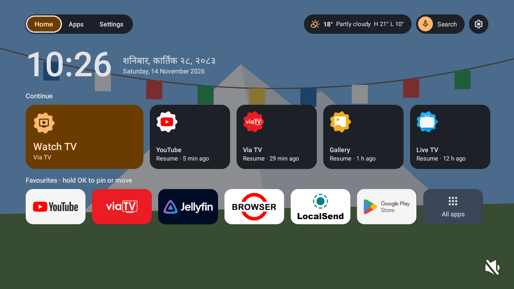
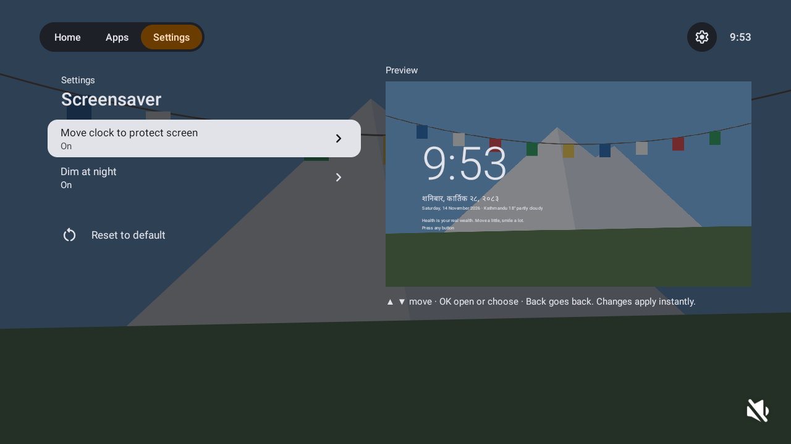

# Summit

A calm, fast home screen for Android TV. Summit puts live TV one press away, keeps your favourite apps in reach,
and shows the time, date and weather at a glance. It works in 40+ languages, with local date formats and an
optional regional calendar. It is built to stay light on 1 GB TV boxes.



## Features

### Home
- **Watch TV** first: one press of OK opens your TV input (HDMI, AV, antenna) or live-TV app.
- **Continue**: the apps you used last, with how long ago (needs usage access, see [Installation](#installation)).
- **Favourites**: your pinned apps; hold OK to pin, unpin or move them.
- Large clock with the date (and an optional regional calendar date), a daily health tip, and live match scores.
- Header with Home, Apps and Settings, a weather chip that opens a full forecast, voice search and the TV's own settings.

### Apps
Every installed TV app in one alphabetical grid. Holding OK (or pressing Menu) opens a side panel to pin to
Favourites, move, open app info or uninstall.

| Apps | App menu |
|---|---|
|  |  |

### Settings
Android TV style lists with a live preview of Home beside them, so every change is visible as you make it.
Inside **Screensaver**, the preview shows the screensaver instead.

| Settings | Screensaver preview |
|---|---|
|  |  |

| Category | Options |
|---|---|
| Theme | Mode (auto by time, dark, light), wallpaper (7 illustrations or a picture from the TV), wallpaper dim, colour (from wallpaper, coral, green or 9 custom colours), contrast, animations |
| Font | Text size, regional digits |
| Language | 43 languages with local date formats, time format, calendar |
| Weather | Location (current or any city), units, show on Home |
| Home screen | Watch TV tile, Continue row, favourites order, health tip |
| Live TV | TV input or app, open Watch TV when the TV starts |
| Icons & tiles | Tile size, tile shape (rounded or square), app names (always, when selected, off) |
| Scores | Leagues, how many, live first, stale scores |
| Screensaver | Use as screensaver, live scores, move clock to protect the screen, dim at night |

With **Colour › From wallpaper**, a picture wallpaper sets the theme colour to the closest of the 9 colours.

### First-run setup
A short guided setup in the same style, with a live preview of Home: where you watch TV, favourite apps, wallpaper,
look (mode and colour), language, and scores. Every choice applies immediately and can be changed later in
Settings; **Settings › Run first-time setup** opens it again.


### Ambient screensaver
A quiet clock with the dates, weather, health tip and live scores over a faded wallpaper. It shifts every minute to
protect the screen from burn-in and dims at night. See [Set Summit as the screensaver](#set-summit-as-the-screensaver).


## OS support

| | |
|---|---|
| Platform | Android TV and Google TV (leanback launcher apps) |
| Android version | 8.0 (API 26) or newer; targets Android 14 (API 34) |
| Tested on | Xiaomi Mi TV (MiTV-AXSO0), Android 9 |
| Memory | Designed for 1 GB boxes |
| Not supported | Phones and tablets (it is a TV launcher), Fire TV (Amazon blocks third-party home screens) |

Notes by version and device:
- **Picture wallpapers** ask for photo access: *Files and media* on Android 8–12, *Photos* on Android 13 and newer.
- **Google TV** devices give their stock launcher priority; disable it as shown in
  [Make Summit the default home screen](#make-summit-the-default-home-screen). Some Google TV builds do not allow
  another home screen at all; Summit then still runs from the app list.
- **Screensaver settings** are missing on some TVs (Mi TV shows a photo-album picker instead), so Summit can set
  itself as the screensaver after a one-time grant.

## Installation

### 1. Build
Requirements: JDK 17, Android SDK platform 34. The Gradle 8.7 wrapper is included.

```sh
./gradlew assembleProdDataRelease        # app/build/outputs/apk/prodData/release/app-prodData-release.apk
./gradlew testFakeDataDebugUnitTest      # calendar, units, score ordering, picture colour
```

| Variant | Data |
|---|---|
| `prodData` | Live weather (Open-Meteo) and live scores (ESPN public scoreboard) |
| `fakeData` | Demo weather and scores from the product spec, no network |

Local release builds are signed with the debug key so they can be sideloaded; signed releases come from
[GitHub Actions](#releases-and-ci). On Windows, if the unit tests fail with `Could not find or load main class Files\...`,
your `PATH` contains a stray `"` character; remove it or run with a cleaned `PATH`.

Pre-built, signed APKs are attached to each [GitHub release](../../releases).

### 2. Install on the TV
Turn on developer options and network debugging on the TV, then from a computer on the same network:

```sh
adb connect <tv-ip-address>
adb install -r app/build/outputs/apk/prodData/release/app-prodData-release.apk
adb shell appops set np.exendahal.summitlauncher GET_USAGE_STATS allow   # Continue row (recent apps)
```

Without the last command Summit asks for usage access at the end of setup instead.

### 3. Make Summit the default home screen
On most TVs, press Home and choose Summit, or open **Settings › Apps › Default apps › Home app**.

Google TV's stock launcher (`com.google.android.tvlauncher`) has a higher priority, so Android ignores any other
choice. Disable it for the current user, then set Summit:

```sh
adb shell pm disable-user --user 0 com.google.android.tvlauncher
adb shell cmd package set-home-activity np.exendahal.summitlauncher/.HomeActivity
```

To restore the stock launcher:

```sh
adb shell pm enable com.google.android.tvlauncher
adb shell cmd package set-home-activity com.google.android.tvlauncher/.MainActivity
```

### 4. First run
Pressing Home opens first-run setup. Choose your TV input or live-TV app, favourite apps, wallpaper, look and
language, then **Finish**.

## Set Summit as the screensaver

**Option A: from Summit (any TV).** Android only lets an app change the system screensaver after a one-time grant:

1. Connect to the TV with `adb connect <tv-ip-address>`.
2. Grant the permission:
   ```sh
   adb shell pm grant np.exendahal.summitlauncher android.permission.WRITE_SECURE_SETTINGS
   ```
3. On the TV, open **Settings › Screensaver** in Summit and turn on **Use as screensaver**.

Turning it off again restores the screensaver Summit replaced. Without the grant, the option opens the TV's own
screensaver settings, or shows the command above on TVs that have none.

**Option B: from the TV's settings.** On TVs with a standard screensaver menu, open
**Settings › Device Preferences › Screen saver** and choose **Summit ambient**. **When to start** sets the delay.

**Option C: over ADB only**, without the grant:
```sh
adb shell settings put secure screensaver_components np.exendahal.summitlauncher/.AmbientDreamService
adb shell settings put secure screensaver_enabled 1
```

To try it straight away, start the screensaver with
`adb shell am start -n com.android.systemui/.Somnambulator`; any button returns to Home.

## How it works

### Weather location
By default weather follows the TV's current location, found once a day from its public IP address (ipapi.co,
falling back to ipwho.is). The detection is city-level and stops once you choose a city. Open the weather chip on
Home (or **Settings › Weather › Location**) to use the current location or search any city through Open-Meteo
geocoding.

### Scores
Home only shows matches that are live, start within the next hour, or finished within the last hour; otherwise the
scores row is hidden. `prodData` reads ESPN's public scoreboard (`site.api.espn.com`, unofficial, no key) for
Premier League, LaLiga, Champions League, Serie A, Bundesliga, Ligue 1, NBA, NFL, NHL and MLB, refreshing every
60 s while a match is live and every 15 min otherwise. Cricket (IPL, Big Bash, internationals), EuroLeague,
tennis, F1, MotoGP and golf have no source yet. Google is not used: it has no scores API, and scraping its result
pages is against its terms.

## Architecture
A single activity with one screen per feature. The code is in `app/src/main/java/np/exendahal/summitlauncher/`:

| Class | Role |
|---|---|
| `HomeActivity` | HOME activity: hosts the screens with a fade-through, wallpaper layer, Home/Search/Settings keys, Back hierarchy, minute tick, package changes |
| `Screen` | Base for the screens: shared header (nav bar, gear, clock) and nav focus |
| `HomeFragment` | Clock and dates, weather chip, score chips, Watch TV, Continue and Favourites rows, move mode |
| `AppsFragment` | All TV apps in an alphabetical grid with the app menu |
| `SettingsFragment` | Categories → options → values, with grids for wallpapers, colours and pictures |
| `SetupFragment` | First-run setup |
| `PrefRow` | The Android TV settings row shared by Settings and setup |
| `Preview` | Settings and setup preview: Home or the screensaver from their own layouts, scaled down |
| `AmbientDreamService` | Screensaver, burn-in shift, night dim; switching the system screensaver |
| `TileAdapter`, `FocusMemoryRecyclerView`, `Ui` | Tiles and focus visuals, row focus memory, shared UI helpers |
| `ThemeController` | Dark/light/auto, colour overlays, high contrast, wallpaper, picture → nearest colour |
| `CustomWallpaper` | Picture wallpapers from the TV's MediaStore, saved scaled and upright in app storage |
| `Prefs` | Settings storage |
| `AppsRepo`, `TvSource` | Installed apps, favourites, recents, Watch TV input/app launch, voice search |
| `Weather`, `Scores`, `BikramSambat` | Open-Meteo client and cache, score model and ordering, calendar conversion |
| `Dialogs` | Weather, score, app menu, city picker and confirmation dialogs |

The calendar month table in `res/raw/bs_calendar.json` comes from the MIT-licensed `nepali-date-converter` 3.4.2.

The product spec is in `Himal_Launcher_PRD.md`. To stay light on 1 GB boxes, the implementation uses a simpler
stack than the spec suggests:

| Spec | Summit | Upgrade when |
|---|---|---|
| Hilt, ViewModel/LiveData | Plain singletons, fragments bind directly | Screens get tested in isolation or grow state |
| Room | SharedPreferences (favourites list, weather JSON cache) | Data outgrows a few KB |
| Retrofit/OkHttp/Moshi | `HttpURLConnection` + `org.json` | More than one API |
| WorkManager refresh | Refresh on Home resume when the cache is over 30 min old | Background freshness matters |
| Bundled Roboto Flex / Noto fonts | System fonts (Android ships the Noto scripts) | Variable-width typography is required |

## Releases and CI
Two GitHub Actions workflows live in `.github/workflows/`:

| Workflow | Runs on | Does |
|---|---|---|
| `pr-check.yml` | Pull requests into `develop` | Builds the release APK, runs the unit tests and lint |
| `release.yml` | Pushing a tag that starts with `v` | Builds a signed APK, verifies the signature and publishes a GitHub release with it |

To publish a release, tag a commit and push the tag:

```sh
git tag v0.1.0
git push origin v0.1.0
```

The tag sets the version name (`v0.1.0` becomes `0.1.0`) and the workflow run number sets the version code. Tags
with a suffix, such as `v0.2.0-beta.1`, are published as pre-releases.

The release workflow signs with these repository secrets (**Settings › Secrets and variables › Actions**):

| Secret | Value |
|---|---|
| `ANDROID_KEYSTORE_BASE64` | The keystore file encoded as one line of base64 |
| `ANDROID_KEYSTORE_PASSWORD` | Keystore password |
| `ANDROID_KEY_ALIAS` | Alias of the signing key |
| `ANDROID_KEY_PASSWORD` | Password of the signing key |

To build a signed APK locally, set the same values as environment variables, with `ANDROID_KEYSTORE_PATH` pointing
to the keystore file instead of the base64 secret.

## Contributing
Bug reports, ideas and pull requests are welcome.

- **Report a bug** with the *Bug report* form under Issues. Include the TV or box model, Android version and the remote
  buttons that lead to the problem; for crashes, attach `adb logcat -d > summit-log.txt`.
- **Suggest a feature** with the *Feature request* form, describing how it would work with a TV remote.
- **Open a pull request** using the template: say what changed and how you tested it, make sure
  `./gradlew assembleProdDataRelease testFakeDataDebugUnitTest lintProdDataRelease` passes, and add screenshots for
  UI changes.

The forms and template live in [`.github/`](.github).

## License
Summit is released under the [MIT License](LICENSE).

It includes the calendar month table from `nepali-date-converter` 3.4.2, also under the MIT License.
