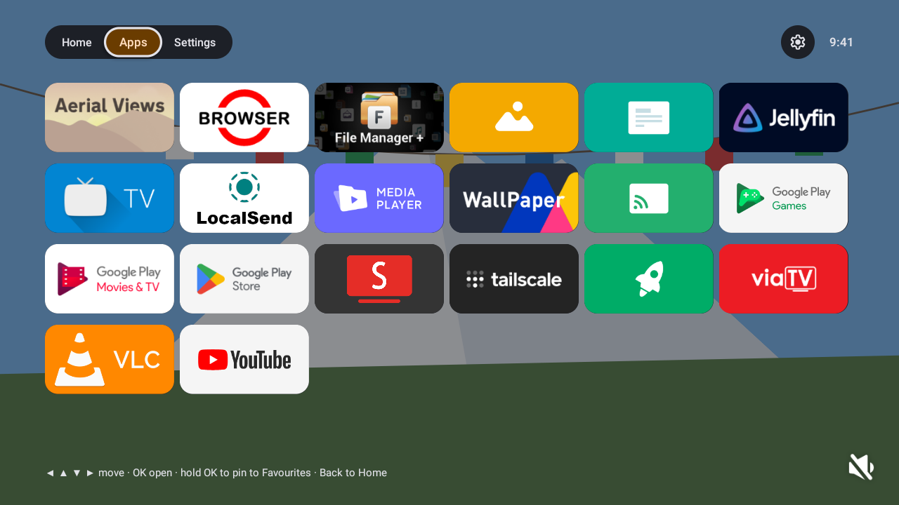
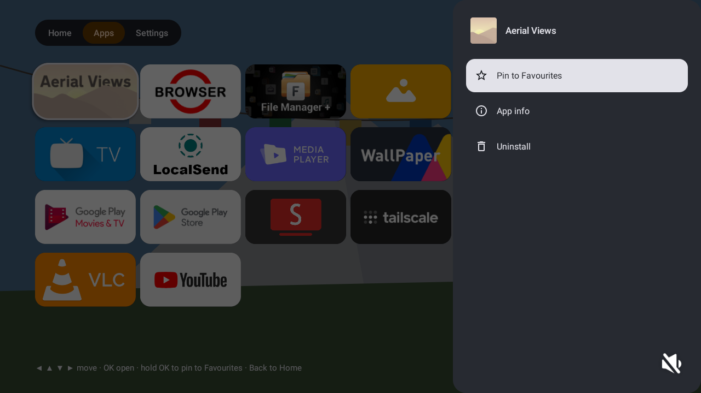
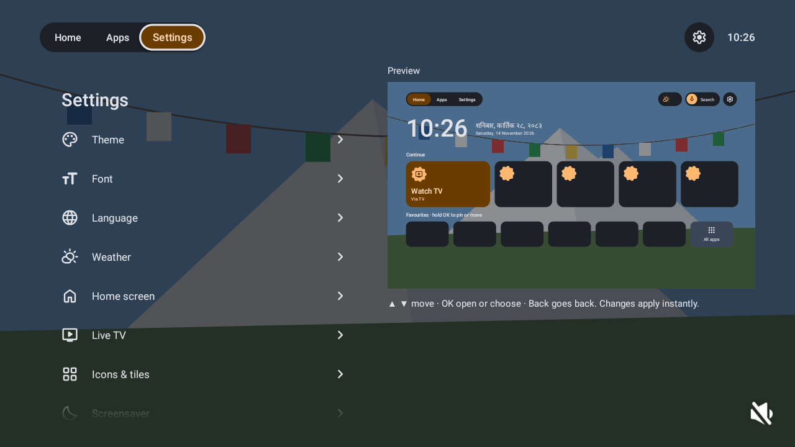
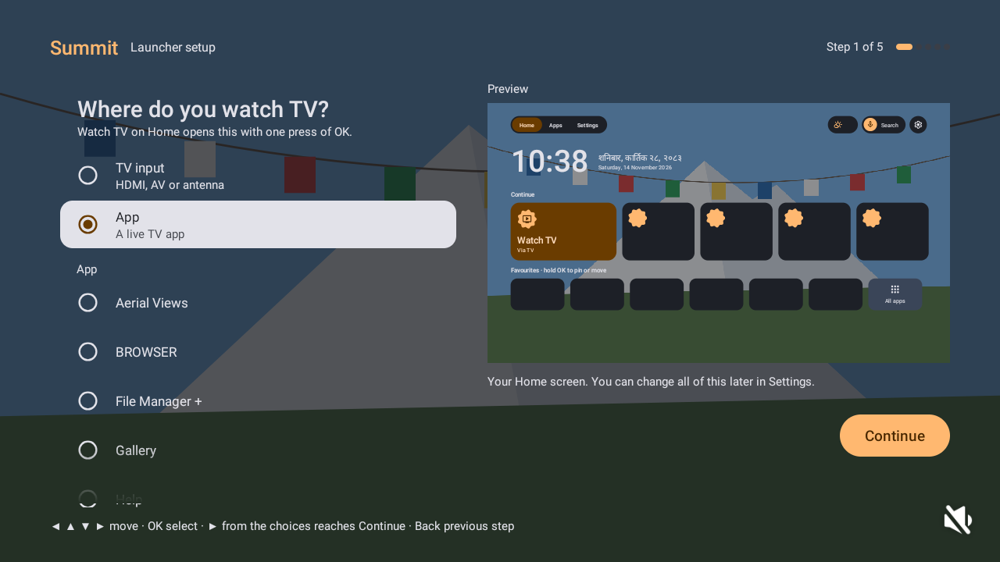
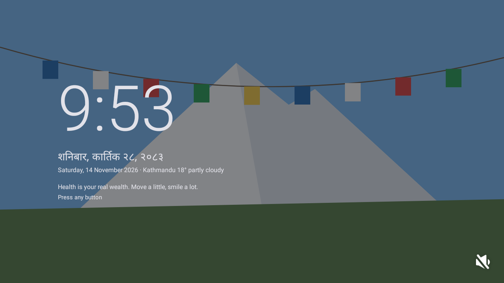

# Summit

A calm, fast home screen for Android TV. Summit puts live TV one press away, keeps your favourite apps in reach,
and shows the time, date and weather at a glance. It is translated into 43 languages, with local date formats and an
optional regional calendar. It is built to stay light on 1 GB TV boxes.


## Features

### Home
- **Watch TV** first: one press of OK opens your TV input (HDMI, AV, antenna) or live-TV app.
- **Continue**: the apps you used last, with how long ago (needs usage access, which Summit asks for at the end of setup).
- **Favourites**: your pinned apps; hold OK to pin, unpin or move them.
- Large clock with the date (and an optional regional calendar date) and a daily health tip.
- Header with Home, Apps and Settings, a weather chip that opens a full forecast, voice search and the TV's own settings.

### Apps
Every installed TV app in one alphabetical grid. Holding OK (or pressing Menu) opens a side panel to pin to
Favourites, move, open app info or uninstall.

| Apps | App menu |
|---|---|
|  |  |

### Settings
Android TV style lists with a live preview of Home beside them, so every change is visible as you make it.
Inside **Screensaver**, the preview shows the screensaver instead.

| Settings | Screensaver preview |
|---|---|
|  |  |

| Category | Options |
|---|---|
| Theme | Mode (auto by time, dark, light), wallpaper (built-in, [community](#community-wallpapers) or a picture from the TV), wallpaper dim, colour (from wallpaper, coral, green or 9 custom colours), contrast, animations |
| Font | Text size, regional digits |
| Language | 43 fully translated languages with local date formats, time format, calendar |
| Weather | Location (current or any city), units, show on Home |
| Home screen | Watch TV tile, Continue row, favourites order, health tip |
| Live TV | TV input or app, open Watch TV when the TV starts |
| Icons & tiles | Tile size, tile shape (rounded or square), app names (always, when selected, off) |
| Screensaver | Use as screensaver, move clock to protect the screen, dim at night |

With **Colour › From wallpaper**, a picture wallpaper sets the theme colour to the closest of the 9 colours.

### Community wallpapers
Besides the built-in illustrations, Summit offers mountain wallpapers from this repository's
[`wallpapers/`](wallpapers) folder. When the TV is online it checks the list once a day; a wallpaper is downloaded the
first time it is picked and then works offline, so new wallpapers never make the app bigger. Anyone can add one with a
pull request; see [wallpapers/README.md](wallpapers/README.md).

### First-run setup
A short guided setup in the same style, with a live preview of Home: where you watch TV, favourite apps, wallpaper,
look (mode and colour) and language. Every choice applies immediately and can be changed later in
Settings; **Settings › Run first-time setup** opens it again.



### Ambient screensaver
A quiet clock with the dates, weather and health tip over a faded wallpaper. It shifts every minute to
protect the screen from burn-in and dims at night. See [Set Summit as the screensaver](#set-summit-as-the-screensaver).



## OS support

| | |
|---|---|
| Platform | Android TV and Google TV (leanback launcher apps) |
| Android version | 8.0 (API 26) or newer; targets Android 14 (API 34) |
| Tested on | Xiaomi Mi TV (MiTV-AXSO0), Android 9 |
| Memory | Designed for 1 GB boxes |
| Not supported | Phones and tablets (it is a TV launcher), Fire TV (Amazon blocks third-party home screens) |

Notes by version and device:
- **Picture wallpapers** ask for photo access: *Files and media* on Android 8–12, *Photos* on Android 13 and newer.
- **Google TV** devices give their stock launcher priority over other home screens, and some builds do not allow
  another home screen at all; Summit then still runs from the app list.
- **Screensaver settings** are missing on some TVs (Mi TV shows a photo-album picker instead), so Summit can set
  itself as the screensaver after a one-time grant.

## Set Summit as the screensaver

**Option A: from Summit (any TV).** Android only lets an app change the system screensaver after a one-time grant:

1. Connect to the TV with `adb connect <tv-ip-address>`.
2. Grant the permission:
   ```sh
   adb shell pm grant np.exendahal.summitlauncher android.permission.WRITE_SECURE_SETTINGS
   ```
3. On the TV, open **Settings › Screensaver** in Summit and turn on **Use as screensaver**.

Turning it off again restores the screensaver Summit replaced. Without the grant, the option opens the TV's own
screensaver settings, or shows the command above on TVs that have none.

**Option B: from the TV's settings.** On TVs with a standard screensaver menu, open
**Settings › Device Preferences › Screen saver** and choose **Summit ambient**. **When to start** sets the delay.

**Option C: over ADB only**, without the grant:
```sh
adb shell settings put secure screensaver_components np.exendahal.summitlauncher/.AmbientDreamService
adb shell settings put secure screensaver_enabled 1
```

To try it straight away, start the screensaver with
`adb shell am start -n com.android.systemui/.Somnambulator`; any button returns to Home.

## How it works

### Weather location
By default weather follows the TV's current location, found once a day from its public IP address (ipapi.co,
falling back to ipwho.is). The detection is city-level and stops once you choose a city. Open the weather chip on
Home (or **Settings › Weather › Location**) to use the current location or search any city through Open-Meteo
geocoding.

## Contributing
Bug reports, ideas and pull requests are welcome.

- **Report a bug** with the *Bug report* form under Issues. Include the TV or box model, Android version and the remote
  buttons that lead to the problem; for crashes, attach `adb logcat -d > summit-log.txt`.
- **Suggest a feature** with the *Feature request* form, describing how it would work with a TV remote.
- **Add a wallpaper** by following [wallpapers/README.md](wallpapers/README.md).
- **Improve a translation.** Most languages were machine-translated and welcome a native speaker's review; they live in
  `app/src/main/res/values-<language>/`. New text must be added to every language: the PR check fails otherwise.
- **Open a pull request** using the template: say what changed and how you tested it, make sure
  `./gradlew assembleProdDataRelease testFakeDataDebugUnitTest lintProdDataRelease` passes, and add screenshots for
  UI changes.

## License
Summit is released under the [MIT License](LICENSE).

It includes the calendar month table from `nepali-date-converter` 3.4.2, also under the MIT License.
